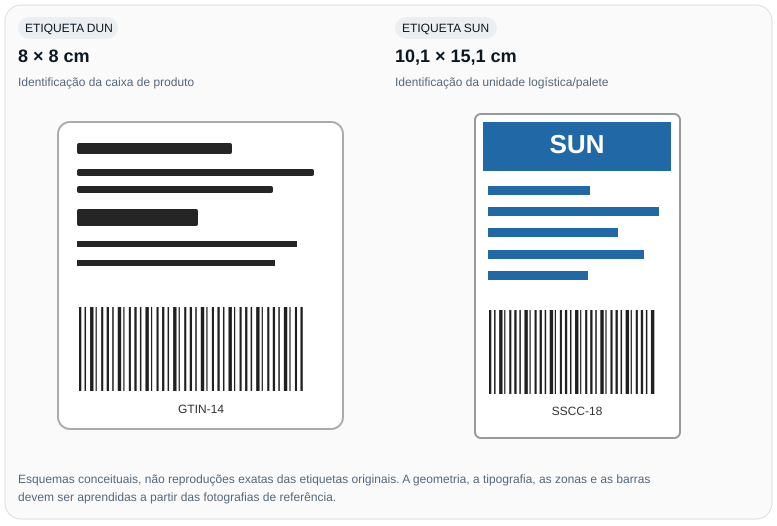

# PRO-ACT Mobile — Reconhecimento de Etiquetas DUN e SUN

Aplicativo mobile para acompanhamento operacional e inspeção de etiquetas industriais de caixa (DUN) e unidade logística/palete (SUN).

## Comparativo visual das etiquetas



> Ilustração vetorial baseada no esquema de referência fornecido. Não é uma reprodução fiel das etiquetas impressas nem o arquivo PNG original. Os códigos de barras desenhados são apenas ilustrativos, não devem ser decodificados.

| Característica | DUN | SUN |
| --- | --- | --- |
| Aplicação | Caixa de produto | Palete / unidade logística |
| Dimensões físicas | **8 × 8 cm** (80 × 80 mm) | **10,1 × 15,1 cm** (101 × 151 mm) |
| Identificador | GTIN-14, quando aplicável e confirmado | SSCC-18 |
| Reconhecimento | OCR e leitura óptica do código | OCR, leitura do código e validação logística |

## Aplicativo

**[Abrir PRO-ACT Mobile no GitHub Pages](https://balancerec.github.io/reconhecimento-etiqueta-sun/)**

O reconhecimento por OCR e a decodificação de códigos são processos distintos. Uma leitura textual não deve ser apresentada como validação do código de barras sem decodificação real.

## Referências

- [Diagrama vetorial DUN × SUN](docs/etiquetas-dun-sun.svg)


## Backend integrado

A página mantém o modo **Neste navegador** e agora oferece **Backend local / servidor** para os scanners DUN e SUN. Configure o motor no painel de etiquetas. No modo backend, a foto é enviada à API selecionada; não há troca silenciosa para OCR no navegador se a conexão falhar.

### Iniciar página e API juntas

Com Docker Desktop instalado, execute na raiz deste repositório:

```powershell
docker compose up --build -d
```

Abra **http://localhost:8000**. Deixe o endereço da API vazio para usar o próprio servidor. A documentação HTTP fica em **http://localhost:8000/docs**. O contêiner instala Tesseract português/inglês e ZXing; o reconhecimento ocorre no servidor, sem serviços de IA externos.

### Usar a página do GitHub Pages

GitHub Pages serve HTML e JavaScript, mas não executa Python/Tesseract. Hospede o backend separadamente com HTTPS e informe sua URL no painel. A origem `https://balancerec.github.io` já está na lista CORS. Para outra origem, ajuste `CORS_ORIGINS` no compose.

O compose fornecido atende somente localhost. Antes de exposição em rede, configure autenticação, HTTPS, controle de acesso, limites de concorrência e retenção dos arquivos. Este projeto não provisiona um servidor público.

### Fluxo de inspeção

1. Escolha o motor e teste a conexão.
2. Envie uma foto pelo scanner DUN ou SUN.
3. Selecione a etiqueta no painel de resultado do backend.
4. Revise campos, erros e avisos. O formulário correspondente recebe os dados da etiqueta selecionada.
5. Para corrigir no servidor, edite os campos **do painel do backend**, informe operador e motivo e salve. As correções preservam os valores anteriores.
6. Exporte o JSON para incluir as evidências OCR, barras, validações e histórico de correções.

O botão original de registro SUN continua gravando no histórico local do navegador, incluindo o resultado do backend. Correções no servidor e parecer humano local são registros distintos. O backend não aprova automaticamente etiquetas.

### API e armazenamento

- `POST /v1/recognize`: multipart com campo `image`, máximo 12 MB.
- `GET /v1/inspections/{id}`: recuperar inspeção.
- `POST /v1/inspections/{id}/corrections`: correção auditável.
- `GET /health`: disponibilidade do Tesseract.

Originais e resultados ficam em `./data`, fora do Git. Faça backup dessa pasta. Execute somente um processo Uvicorn nesta versão.

### Validação e limites

Passaram 14 testes Python de regras e contrato HTTP, mais os testes JavaScript de transporte, configuração, cancelamento, respostas antigas e correções. Os testes HTTP usam OCR/decoder simulados. Sintaxe dos scripts da página e do Python verificada. Não foi executado Docker, OCR real nem teste visual no navegador neste ambiente.

A detecção separa regiões azuis SUN; fotos com várias DUN ou DUN e SUN juntas ainda exigem um detector melhor. Não há retificação de perspectiva, catálogo completo de descrições ou confiança calibrada. `product_description` permanece ausente no extrator atual. A lista de campos e avisos deixa essas pendências visíveis. Revisão humana obrigatória.

```powershell
cd backend
python -m pip install -r requirements.txt -r requirements-dev.txt
python -m unittest discover -s tests -v
cd ..
node test-integration.cjs
node test-ui-flow.cjs
```

